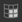
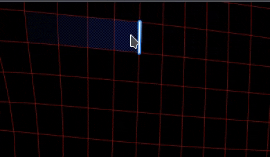

# Preenchimento de polígono

A ferramenta **Preenchimento de Polígono** preenche polígonos com valores de canal de material ou valores de máscara em tons de cinza. Pode ser usado em camadas de tinta, efeitos e máscaras para preencher rapidamente regiões da malha.

Essa ferramenta é mais uma ferramenta de pintura do que uma ferramenta de seleção. Por isso, depois de usada, ela só pode ser apagada por meio da ferramenta borracha ou preenchendo-a.

A ferramenta pode ser acessada pela barra de ferramentas:

## Configurações

Abaixo está a lista de configurações disponíveis com a ferramenta **Preenchimento de Polígono** por meio da janela **Propriedades**.

### Modo de seleção

O modo de seleção controla como triângulos e quads da geometria de malha são selecionados.

| **Modo** | **Descrição** |
|---|---|
|  **Preenchimento de letreiro retangular** | Desenhe uma seleção retangular clicando e arrastando. O **modo de preenchimento** define a geometria que está preenchida, enquanto o **teste de ocorrência** define quais polígonos estão incluídos.    |
|  **Preenchimento de loop de polígono** | Preencha um loop completo de quads com um único clique. Arrastar seleciona vários loops.    |
|  **Preenchimento parcial de loop de polígono** | Preencha uma parte de um loop clicando e arrastando. A seleção pode se estender ao longo de loops secundários para formar um patch de polígonos.    |

### Modo de Preenchimento

O modo de preenchimento, que só pode ser usado com o modo **Preenchimento de letreiro retangular**, controla quais partes da geometria são selecionadas.

| **Modo** | **Descrição** |
|---|---|
|  **Preenchimento triangular** | Preencha triângulos de malha individuais. |
|  **Preenchimento de polígono** | Preencha polígonos inteiros. Em uma malha triangulada antes da importação, o resultado é o mesmo que **Preenchimento triangular**. |
|  **Preenchimento de malha** | Preencha todos os polígonos conectados ao que foi clicado. |
|  **Preenchimento de parte UV** | Preencher polígonos conectados no espaço UV. O preenchimento para nas bordas UV. |

### Teste de hit

As configurações do teste de ocorrência controlam como triângulos e quads são selecionados pelo modo de **Preenchimento de letreiro retangular**.

| **Modo** | **Descrição** |
|---|---|
|  **Interseção** | (padrão) Um polígono é preenchido se qualquer parte de sua geometria estiver dentro ou fizer interseção com a área de seleção. |
|  **Centro contido** | Um polígono é preenchido somente se o seu ponto central estiver dentro da área de seleção. |
| **Somente polígonos visíveis** | Se ativado, o preenchimento afeta apenas os polígonos visíveis na visualização de câmera atual. Polígonos ocultos e invertidos são ignorados. Se desativada, os polígonos podem ser preenchidos através da malha. |

### Mesclagem

Essas configurações controlam como o resultado do preenchimento é misturado aos pixels subjacentes.

| **Parâmetro** | **Descrição** |
|---|---|
| Modo de mesclagem | Controla como o preenchimento é mesclado com valores de pixel existentes. No modo **Material**, o modo de mesclagem se aplica a todos os canais habilitados na seção **Material**. |
| Opacidade | Controle a opacidade do preenchimento. |

>[!NOTE]
>
> A ferramenta oferece suporte aos mesmos modos de mesclagem disponíveis na pilha de camadas. Para obter mais informações, consulte a [página de documentação sobre modos de mistura](https://experienceleague.adobe.com/pt-br/docs/substance-3d-painter/using/interface/layer-stack/blending-modes).

### Material

A seção de material controla quais canais podem ser habilitados para pintura pela ferramenta.

## Atalhos

A ferramenta de preenchimento de polígono pode ser usada eficientemente com a ajuda de atalhos de teclado específicos:

| **Atalho** | **Descrição** |
|---|---|
| **Alt** | Com o **Preenchimento de loop de polígono** e o **Preenchimento de loop de polígono parcial**, este atalho estende a seleção do outro lado do clique inicial ao arrastar.    |
| **Turno** | Com o **Preenchimento parcial de loop de polígono**, este atalho preenche somente o loop primário, ignorando os loops secundários. Exemplo de alternância de **Shift**:    |
| **Shift + A** | Este atalho alterna temporariamente para o **Preenchimento de loop de polígono** de qualquer outro modo de seleção. Se o atalho for solto antes do botão do mouse, a seleção continuará até o botão do mouse ser solto. |
| **A** | Se esse atalho for pressionado ao arrastar, o resultado atual será combinado com o resultado anterior. Isso funciona em modos de mesclagem e opacidades:    |

## Limitações

Algumas limitações se aplicam à ferramenta:

* O **preenchimento de loop de polígono** e o **preenchimento parcial de loop de polígono** funcionam somente em quads, portanto, triângulos e n-gonos não podem ser preenchidos com esses modos.
* O suporte a **simetria radial** também é limitado e pode não ser confiável. Para usar o simetria, prefira usar o modo de espelho. Consulte a [página de documentação do simetria](https://experienceleague.adobe.com/pt-br/docs/substance-3d-painter/using/painting/symmetry/symmetry) para obter mais informações.
* A ferramenta preenche a geometria somente a partir do **Conjunto de Texturas ativo**. O wireframe é exibido para esse conjunto de texturas e é atualizado quando o conjunto de texturas ativo é alterado.
