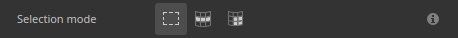
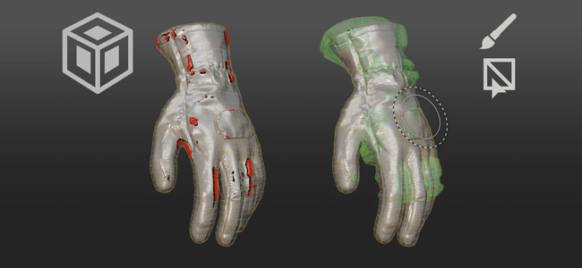
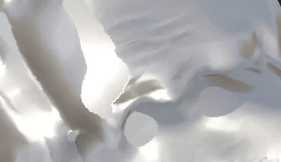
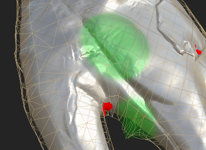

# Versão 12.2

O **Substance 3D Painter 12.2** traz uma ferramenta de preenchimento de polígono aprimorada com seleção baseada em loop, pintura em gaiola para fça bake, realce de conjunto de texturas no visor e transparência independente de ordem para renderização em tempo real.

Data de lançamento: **21 de outubro de 2026**

## Principais recursos

### Preenchimento de polígono aprimorado

A ferramenta **Preenchimento de polígono** foi reformulada com uma nova interface e novos modos de seleção para loops de polígono. A ferramenta agora também suporta modos de mesclagem com um controle de opacidade e pode trabalhar em vários canais de uma só vez. A seleção também manipula a oclusão, o que significa que os polígonos ocultos da câmera serão ignorados.

* **Interface aprimorada**

  As configurações de **Preenchimento de Polígono** na janela **Propriedades** foram modificadas para facilitar o uso. As opções agora são exibidas como linhas de botões, agilizando a alternância entre os modos. Novos ícones de dica de ferramenta descrevem como cada modo funciona.

  

* **Novos modos de seleção**

  Dois novos modos dedicados a loops de polígono foram adicionados à linha **Modo de seleção**:

  

  * **Preenchimento de loop de polígono**: este modo preenche um loop completo de quads com um único clique. Manter **Alt** pressionado enquanto arrasta também estende a seleção na direção oposta.

    

  * **Preenchimento parcial de loop de polígono**: esse modo preenche apenas uma parte de um loop, e arrastar ao longo do loop estende a seleção. Ao arrastar, as setas mostram o fluxo da topologia em cada lado da seleção para ajudar a prever alterações inesperadas no caminho. Uma dica de ferramenta ao lado do cursor mostra o número de polígonos selecionados em ambos os eixos. Manter **Alt** pressionado enquanto arrasta também estende a seleção na direção oposta.

    

  Manter **Shift + A** pressionado também alterna temporariamente para **Preenchimento de loop de polígono** de qualquer modo de seleção. Se o atalho for solto antes do botão do mouse, a seleção continuará até o botão do mouse ser solto.

* **O modo de preenchimento alterna o modo de seleção**

  As opções do **Modo de preenchimento** não se aplicam aos modos de **Preenchimento de loop de polígono** e **Preenchimento parcial de loop de polígono**. Por esse motivo, selecionar um modo de preenchimento mudará automaticamente o **modo de seleção** de volta para o principal.

  

* **Nova opção de teste de Acerto**

  A nova opção **Teste de ocorrência** controla quais polígonos estão incluídos na área de seleção. Descartar polígonos não visíveis agora é o comportamento padrão, pois a opção **Somente polígonos visíveis** está habilitada por padrão. Desativar essa opção restaura o comportamento anterior de preenchimento através da malha.

  As opções disponíveis são:

  * **Interseção**: (padrão) um polígono é preenchido se qualquer parte dele estiver dentro da área de seleção ou cruzar sua borda.
  * **Centro contido**: um polígono é preenchido somente se o seu ponto central estiver dentro da área de seleção.
  * **Somente polígonos visíveis**: se habilitada, essa opção preenche somente os polígonos visíveis na exibição atual da câmera. A geometria oculta e invertida é, portanto, ignorada.

  

* **Modos de mesclagem e opacidade**

  A ferramenta **Preenchimento de polígono** agora dá suporte a todos os modos de mesclagem, a mesma lista que está disponível na pilha de camadas. Por exemplo, **Subexposição linear (Adicionar)** adiciona valores aos existentes em vez de substituí-los. Os modos estão disponíveis na nova seção **Mesclagem** da janela **Propriedades**, além do controle deslizante **Opacidade**. No modo **Material**, o modo de mesclagem se aplica a todos os canais habilitados na seção **Material**.

  

* **Preencha vários canais de uma vez**

  A ferramenta **Preenchimento de Polígono** não está mais limitada a um único canal. Todas as propriedades de canal habilitadas na seção **Material** agora podem ser definidas e preenchidas em uma ação.

  

* **Compatível com o simetria**

  O **preenchimento de loop de polígono** e o **preenchimento parcial de loop de polígono** também funcionam com simetria. Um único clique funciona com simetria espelhada (no entanto, a simetria radial pode ser menos confiável).

  

* **Retomar traço anterior**

  O atalho **Retomar traçado anterior** (mantendo **A** pressionado) agora funciona com a ferramenta **Preenchimento de polígono**, incluindo entre modos de mesclagem e opacidades.

  

* **Feedback mais claro entre conjuntos de texturas**

  O wireframe agora é exibido apenas para o Conjunto de Texturas ativo e é atualizado quando a seleção é alterada. Passar o mouse sobre a geometria de outro conjunto de texturas agora mostra um cursor proibido para indicar que a geometria relacionada não pode ser preenchida.

  

>[!NOTE]
>
> Para obter mais informações sobre a ferramenta **Preenchimento de Polígono**, confira a [página de documentação dedicada](https://experienceleague.adobe.com/en/docs/substance-3d-painter/using/painting/paint-tools/polygon-fill).

### Nova pintura em gaiola no modo de Fça bake

O novo **modo de pintura de gaiola** é um deslocamento de gaiola por pixel que pode ser pintado sobre o deslocamento de distância global. Isso significa que a gaiola agora pode ser ajustada pintando diretamente na malha. As áreas onde a malha alta do poli vai para fora da gaiola podem então ser fixadas localmente mais facilmente.

* **Nova pintura do deslocamento da gaiola**

  Um novo botão **Gaiola de Tinta** no modo de Fça bake agora alterna para o modo de pintura da gaiola. Nesse modo, as ferramentas **Tinta**, **Borracha** e **Preenchimento de polígono** podem ser usadas para ajustar a distância da gaiola da malha poli baixa.

  

  Isso é feito pintando uma textura intermediária. Essa textura é então usada como um deslocamento na malha do compartimento durante o fça bake. Isso é semelhante ao processo de **pintura de inclinação**.

  Um parâmetro de **Intensidade** na barra de ferramentas superior define o valor de deslocamento aplicado pelo traçado. Os controles usuais de **Tamanho**, **Fluxo**, **Opacidade do traçado** e **Espaçamento** também estão disponíveis, bem como um botão **Inverter valor**. A Simetria também é compatível.

  

  

* **Usar o Preenchimento de Polígono para selecionar e preencher partes inteiras da malha**

  A ferramenta **Preenchimento de Polígono** pode ajustar a distância da caixa de subobjetos parciais ou completos de uma só vez. Clicar em um elemento abre uma barra de ferramentas flutuante com um controle deslizante de **Intensidade da caixa**. Este controle deslizante aumenta ou encolhe o compartimento em tempo real, começando pelo valor definido na barra de ferramentas superior. Os deslocamentos pintados são então adicionados em cima do deslocamento.

  

* **Visualizar deslocamentos de gaiola no visor**

  Entrar no modo de pintura da gaiola alterna a viewport para um novo modo de visualização. Nesse modo, os deslocamentos são visíveis como uma sobreposição verde sobre a caixa. A gaiola também é deformada para representar a malha da gaiola usada durante o processo de fça bake.

  

  Algumas configurações podem ser controladas por meio do painel **Visualização Feita bake**: a seção **Gaiola** controla as exibições de **Superfície da gaiola** e **wireframe da gaiola**, bem como sua opacidade. Ele também tem uma **opacidade de grade de deslocamento** e uma **força de sombreamento de deslocamento**.

  

* **Modo de mesclagem na barra de ferramentas contextual**

  Alguns modos de mesclagem estão disponíveis diretamente na barra de ferramentas contextual para conveniência. Eles podem ser usados para ajustar o deslocamento da gaiola mais facilmente, notavelmente para adicionar ou subtrair deslocamentos.

  Os modos disponíveis são:

  * **Normal**: substitui o deslocamento existente pelo valor do traçado.
  * **Clarear (Máx)**: mantém o valor mais alto do traçado e do deslocamento existente.
  * **Subexposição linear (Adicionar)**: (padrão) adiciona o valor do traçado ao deslocamento existente.

  

  Há modos de mesclagem adicionais disponíveis com o **Preenchimento de Polígono** usando o menu de contexto no visor.

* **Novo menu de redefinição para pintura em gaiola e inclinação**

  Os modos inclinar e pintar gaiola agora têm um novo menu para redefinir as configurações. As opções disponíveis são:

  * **Redefinir parâmetros de gaiola/inclinação**: redefina os parâmetros da interface do usuário para seus valores padrão.
  * **Limpar todos os traçados de tinta de gaiola/inclinação**: apague a textura usada na pintura de gaiola ou inclinação.
  * **Redefinir e limpar tudo**: combine a redefinição da interface do usuário e o apagamento das texturas de caixa/inclinação.

  

>[!NOTE]
>
> Para obter mais informações sobre como fazer bake, confira a [página de documentação dedicada](https://experienceleague.adobe.com/en/docs/substance-3d-painter/using/baking/baking).

### Novo realce de conjunto de texturas no visor

O novo comportamento de realce agora pode ajudar a identificar quais geometrias no visor 3D estão associadas a um **Conjunto de Texturas** ou a um **Bloco UV**.

* **Realce da lista do Conjunto de Texturas**

  Passar o mouse sobre uma entrada na **lista de Conjuntos de Texturas** agora realça sua geometria no visor, para Conjuntos de Texturas e Blocos UV. Isso facilita a visualização de qual parte da malha pertence a cada conjunto de textura.

  

* **Destaque no visor**

  Manter **Ctrl/Cmd + Alt** pressionado sobre o modelo realça a geometria do Conjunto de Texturas sob o cursor. O realce fica oculto enquanto o botão esquerdo do mouse é pressionado ou enquanto se movimenta, e retorna depois que os modificadores são liberados.

* **Disponível nos modos de pintura e Fça bake**

  O realce funciona nos modos de pintura e fça bake. No modo de fça bake, os Conjuntos de texturas desativados são exibidos em cinza quando destacados.

### Nova transparência independente de ordem

O visor em tempo real agora oferece suporte à transparência independente de ordem. Ela remove os artefatos de classificação e a cintilação que podem aparecer quando várias superfícies transparentes ou translúcidas se sobrepõem.

* **Nova opção nas Configurações de Exibição**

  A opção de **Transparência independente de ordem** pode ser habilitada na seção **Configurações de renderização** das **Configurações de exibição**. Por padrão, ela fica desativada para evitar impactos no desempenho.

  

  Antes e depois de ativar a nova configuração:

  

* **Controle de desempenho**

  Um parâmetro de **Capacidade de classificação** controla o número médio de camadas de transparência que podem ser classificadas por pixel. Valores mais altos melhoram a qualidade da transparência em cenas complexas, mas podem usar mais memória e reduzir o desempenho. As opções disponíveis são:

  * **Baixo (1x)**.
  * **Médio (2x)**.
  * **Alta (4x)** (padrão)
  * **Muito alta (8x)**
  * **Ultra (16x)**

### Melhorias diversas

Recursos e aprimoramentos adicionais foram adicionados nesta versão:

* **Configurações de Exibição Reorganizadas**

  Os parâmetros da janela **Configurações de Exibição** foram reagrupados e reordenados, facilitando a navegação do painel. As configurações agora estão divididas em **Configurações de ambiente**, **Configurações da câmera**, **Pós-efeitos**, **Configurações de renderização** e **Configurações de visualização**. Uma linha de botões na parte superior da janela permite saltar diretamente para cada grupo.

  

* **Mesclagem adicional com pinceladas**

  As configurações do pincel agora oferecem um novo modo de mesclagem aditivo. Com esse modo, os traçados se somam uns sobre os outros na mesma camada, em vez de se substituírem. Isso não se limita a carimbos dentro de um traçado. Com esse novo modo, a cor pode ser adicionada ou o canal de height pode ser esculpido pela adição ou remoção de valores.

  

* **Novo mapa de mecanismo de vizinho UV**

  Uma nova entrada de mapa de mecanismo `mesh_uv_neighbor` está disponível para materiais e filtros de Substance. Funciona como uma textura de advecção UV para encontrar o outro lado de uma costura de Ilha UV. Seus canais vermelho e verde armazenam a advecção UV usada para alcançar o pixel vizinho através de uma costura UV.

  Para obter mais informações sobre essas texturas de mecanismo, consulte a [página de documentação dedicada](https://experienceleague.adobe.com/en/docs/substance-3d-painter/using/content/creating-custom-effects/mesh-based-input).

## Notas de versão

### 12.2.0

Data de lançamento: **2026/10/21**

Resumo: **Esta atualização é uma versão principal. Ela adiciona um novo recurso de Pintura em gaiola para fça bake e faz melhorias na funcionalidade de preenchimento de Polígono. Para obter mais detalhes, consulte as notas de versão completas.**

**Adicionado:**

* Fazendo bake, pintura em gaiola
* &amp;preto;Pintura em gaiola&amp;rbrack; Criar interface de Tinta básica em gaiola
* &amp;preto;Pintura em gaiola&amp;rbrack; Novas opções de Visualização em gaiola
* &amp;preto;Pintura em gaiola&amp;rbrack; Editável Ferramenta Selecionar / Preencher
* &amp;preto;Pintura em gaiola&amp;rbrack; Mostrar Modo Combinar na barra de ferramentas
* &amp;preto;Pintura em gaiola&amp;rbrack; Alterações na interface do controle deslizante HDR
* &amp;preto;Pintura de gaiola&amp;rbrack; sombreador de visualização
* &amp;preto;Pintura em gaiola&amp;rbrack; Redefinir opções da pilha
* Melhorias na ferramenta Preenchimento de polígono
* &amp;Preenchimento de polígono&amp;rbrack; Adicionar correção de polígono
* &amp;Preenchimento de polígono&amp;rbrack; Adicionar loop de polígono
* &amp;Preenchimento de polígono&amp;rbrack; suporte para Simetria com Loop/Correção
* &amp;Preenchimento do polígono&amp;rbrack; visualização da borda da Simetria
* &amp;Preenchimento de polígono&amp;rbrack; Remover triângulos com loops e loops parciais
* &amp;preto;Preenchimento de polígono&amp;rbrack; Wireframe visível somente para o Conjunto de texturas ativo
* &amp;preto;Preenchimento de polígono&amp;rbrack; Realce de borda vermelha em triângulos não clicáveis
* &amp;preenchimento;Preenchimento de polígono&amp;rbrack; Não desative as opções do modo de preenchimento
* &amp;Preenchimento de polígono&amp;rbrack; Permitir a definição de todas as propriedades de canal com o Preenchimento de polígono
* &amp;Preenchimento de polígono&amp;rbrack; Retomar traçado anterior funciona com Preenchimento de polígono
* &amp;preto;Preenchimento de polígono&amp;rbrack; Mostrar cursor proibido em conjuntos de texturas não ativos
* &amp;Preenchimento do polígono&amp;rbrack; ALT visualização instantânea
* &amp;Preenchimento de Polígono&amp;rbrack; Atalho para alternar temporariamente para Polyloop (SHIFT+A)
* &amp;preto;Visor&amp;rbrack; Mostrar conjunto de texturas / realce de seleção de Bloco UV
* &amp;lbrack;Visor&amp;rbrack; Adicionar suporte para Transparência Independente da Ordem no visor em tempo real
* &amp;lbrack;Configurações de exibição&amp;rbrack; Reorganizar as configurações de exibição em novos grupos
* &amp;lbrack;Tool&amp;brack; Adicionar suporte para mesclagem aditiva com pinceladas
* &amp;lbrack;Tool&amp;brack; Adicionar suporte para mesclagem aditiva com Preenchimento de Polígono
* &amp;lbrack;USD&amp;rbrack; O USD exportado com mapa de opacidade torna tudo transparente em Arnold
* &amp;lbrack;Nvidia&amp;rbrack; Adicionar aviso sobre os drivers Nvidia mais recentes (616.56 a 617.14)
* Adicionar nova entrada de mapa do mecanismo “mesh_uv_neighbor”
* Atualize os baker para a versão 3.23.0
* Atualize o mecanismo de Substance para a versão 9.6.1

**Corrigido:**

* &amp;lbrack;Fazendo bake&amp;rbrack; A Oclusão de ambiente Ignorar face de fundo pelo nome da malha não funciona
* &amp;lbrack;Fazendo bake&amp;rbrack; &amp;lbrack;AMD&amp;rbrack; Dispositivo perdido ao fazer bake com malhas pesadas de alta espessura
* &amp;lbrack;Desempenho&amp;rbrack; Painter hogs VRAM uso
* &amp;lbrack;Viewport&amp;rbrack; texturas ausentes ao abrir projetos em telas HDPI
* O modo de mesclagem &amp;preto;Tool&amp;rbrack; fica esmaecido ao pintar em uma máscara
* Pastas temporárias não excluídas após a exportação na rede
* &amp;lbrack;USD&amp;rbrack; A geometria USD exportada é dividida ao longo das bordas UV
* &amp;lbrack;USD&amp;rbrack; Congelar ao carregar USDz malformado
